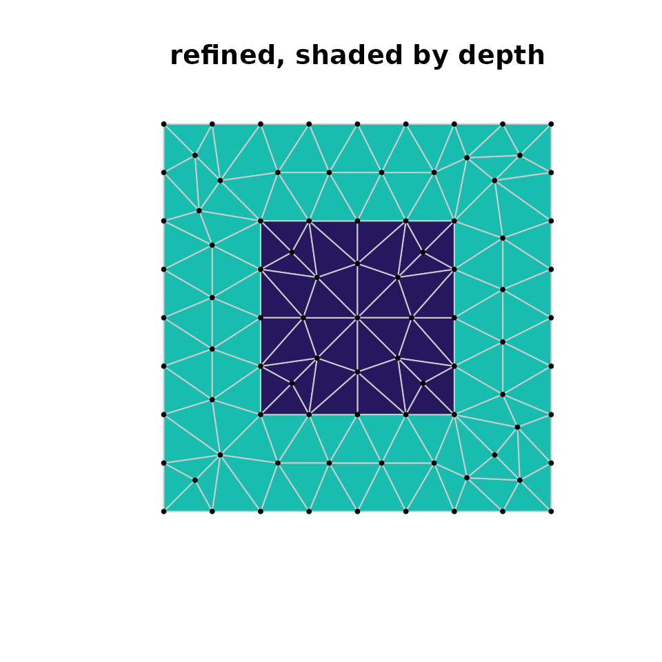
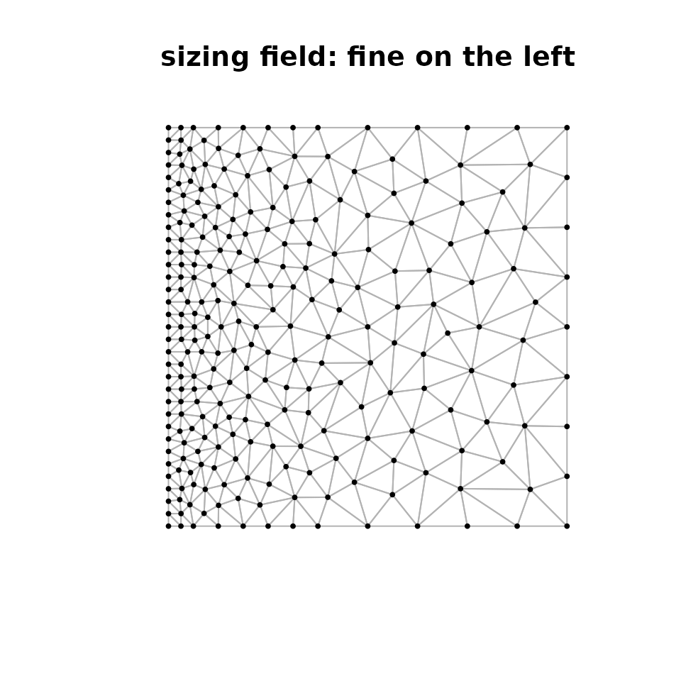

# Getting started with laridae

laridae is the CGAL-backed member of the hypertidy meshing stack. It
wraps CGAL’s 2D constrained Delaunay triangulation and
`Delaunay_mesher_2` behind a *persistent handle* you can edit and refine
incrementally, and it returns the same vertices / segments / triangles
contract as [cdtr](https://github.com/hypertidy/cdtr) so the backend is
a choice, not a rewrite.

For the bigger picture — where laridae sits among cdtr, RTriangle, GEOS
and earcut, and why the triangles are only part of the story — see
[Triangulation in
context](https://mdsumner.github.io/trianglewins/context/).

``` r

library(laridae)
```

This vignette uses a small base-graphics helper to draw a mesh and,
optionally, shade its triangles by a per-triangle value.

``` r

plot_mesh <- function(tab, by = NULL, main = "") {
  V <- tab$vertices; T <- tab$triangles
  plot(V$x, V$y, type = "n", asp = 1, axes = FALSE, xlab = "", ylab = "", main = main)
  if (!is.null(by)) {
    pal <- hcl.colors(max(by, na.rm = TRUE) + 1L, "YlGnBu", rev = TRUE)
    for (i in seq_len(nrow(T))) {
      ix <- c(T$v0[i], T$v1[i], T$v2[i])
      polygon(V$x[ix], V$y[ix], col = pal[by[i] + 1L], border = "grey80")
    }
  } else {
    for (i in seq_len(nrow(T))) {
      ix <- c(T$v0[i], T$v1[i], T$v2[i], T$v0[i])
      lines(V$x[ix], V$y[ix], col = "grey70")
    }
  }
  points(V$x, V$y, pch = 19, cex = 0.4)
}
```

## The contract tables

A triangulation is described by three tables that every hypertidy mesher
shares. Here is a square with a square hole, as two closed rings of
constraint segments.

``` r

x <- c(0, 1, 1, 0, 0.25, 0.75, 0.75, 0.25)
y <- c(0, 0, 1, 1, 0.25, 0.25, 0.75, 0.75)
m <- lari_new(x, y, s0 = 1:8, s1 = c(2, 3, 4, 1, 6, 7, 8, 5))

lari_vertices(m)
#>      x    y origin id
#> 1 0.00 0.00  input  1
#> 2 1.00 0.00  input  2
#> 3 1.00 1.00  input  3
#> 4 0.00 1.00  input  4
#> 5 0.25 0.25  input  5
#> 6 0.75 0.25  input  6
#> 7 0.75 0.75  input  7
#> 8 0.25 0.75  input  8
lari_triangles(m)
#>    v0 v1 v2 depth depth_distinct
#> 1   4  1  5     1              1
#> 2   4  5  8     1              1
#> 3   7  4  8     1              1
#> 4   5  6  8     2              2
#> 5   5  1  6     1              1
#> 6   7  3  4     1              1
#> 7   7  6  2     1              1
#> 8   7  8  6     2              2
#> 9   7  2  3     1              1
#> 10  6  1  2     1              1
lari_segments(m)
#>   v0 v1 segment count
#> 1  1  4       4     1
#> 2  5  8       8     1
#> 3  3  4       3     1
#> 4  1  2       1     1
#> 5  7  8       7     1
#> 6  5  6       5     1
#> 7  2  3       2     1
#> 8  6  7       6     1
```

- **vertices** — `x`, `y`, any attribute columns, the `origin` of each
  vertex (`input`, `crossing`, or `steiner`) and a stable `id`.
- **triangles** — `v0`, `v1`, `v2` (1-based rows of the vertices table),
  `depth` and `depth_distinct` (see below).
- **segments** — the constraint edges `v0`, `v1`, the input `segment` id
  they came from, and `count`, the number of input segments covering the
  edge.

## Depth: inside, holes, and coverage

`depth` counts the constraint crossings on the way in from outside the
convex hull. For nested rings odd is inside and even is a hole, so the
square-with-a-hole has depth 1 in the ring and depth 2 inside the hole.

``` r

table(lari_depth(m))
#> 
#> 1 2 
#> 8 2
```

`depth_distinct` is the same count, but a *doubled boundary* — an edge
covered by several coincident input segments — is crossed once instead
of once per segment. For a simple ring the two agree; they differ when
boundaries are duplicated (a common artefact of per-polygon ring data).

## One-shot triangulation

[`lari_triangulate()`](https://hypertidy.github.io/laridae/reference/lari_triangulate.md)
builds, optionally refines, and returns the three tables in one call —
the drop-in form that mirrors cdtr’s `cdt_triangulate()`.

``` r

r <- lari_triangulate(x, y, s0 = 1:8, s1 = c(2, 3, 4, 1, 6, 7, 8, 5),
                      max_area = 0.01, min_angle = 25)
plot_mesh(r, by = r$triangles$depth, main = "refined, shaded by depth")
```



## The persistent handle

The handle is what sets laridae apart: points and constraints can be
inserted and removed at any time, vertex ids stay stable, and refinement
can continue or restart after an edit touching only the affected
neighbourhood.

``` r

m <- lari_new(x, y, s0 = 1:8, s1 = c(2, 3, 4, 1, 6, 7, 8, 5))
lari_refine(m, max_area = 0.01, min_angle = 25)
lari_counts(m)
#> $input
#> [1] 8
#> 
#> $crossing
#> [1] 0
#> 
#> $steiner
#> [1] 81
#> 
#> $faces
#> [1] 144
#> 
#> $segments
#> [1] 8
#> 
#> $edges
#> [1] 48
#> 
#> $refined
#> [1] TRUE
#> 
#> $mesher_alive
#> [1] TRUE
#> 
#> $min_edge_length
#> [1] 0.025
#> 
#> $unrefined
#>                 bad          shortEdges    sharpFixedCorner circumcenterOutside 
#>                   0                   0                   0                   0 
#>            inserted           budgetHit             stalled 
#>                  81                   0                   0
```

Edit the mesh and refine again — only the neighbourhood of the edit is
redone.

``` r

ids <- lari_add_points(m, c(0.1, 0.15), c(0.1, 0.12))
lari_add_segments(m, ids[1], ids[2])
#> [1] 9
lari_refine(m, max_area = 0.01, min_angle = 25)
lari_counts(m)$steiner
#> [1] 94
```

Or advance the mesher one step at a time with the last criteria.

``` r

lari_step(m, n = 5)
#> [1] 0
```

## Refinement: angle, area, and sizing fields

Beyond a global `min_angle` and `max_area`, laridae takes a **sizing
field**: the local maximum triangle area as a function of position (or a
grid). Here the target area grows with `x`, so triangles are fine on the
left and coarse on the right.

``` r

ms <- lari_new(c(0, 1, 1, 0), c(0, 0, 1, 1), 1:4, c(2, 3, 4, 1))
lari_refine(ms, size = function(x, y) 0.0005 + 0.01 * x)
plot_mesh(lari_tables(ms), main = "sizing field: fine on the left")
```



## Attributes ride along

Per-vertex attributes passed as `PA` are carried onto crossings and
Steiner points by linear interpolation, so a field defined on the inputs
stays consistent through refinement.

``` r

z <- 2 * x + 3 * y + 1   # a linear field on the inputs
ra <- lari_triangulate(x, y, 1:8, c(2, 3, 4, 1, 6, 7, 8, 5),
                       PA = cbind(z = z), max_area = 0.01)
## a linear field is reproduced exactly at every vertex
max(abs(ra$vertices$z - (2 * ra$vertices$x + 3 * ra$vertices$y + 1)))
#> [1] 8.881784e-16
```

## Where to next

- [`?lari_refine`](https://hypertidy.github.io/laridae/reference/lari_refine.md)
  for the full refinement arguments, including `seeds`, the `erase`
  region, and the edge-length floor.
- [cdtr](https://github.com/hypertidy/cdtr) for the header-only,
  builds-anywhere backend with the same contract.
- [Triangulation in
  context](https://mdsumner.github.io/trianglewins/context/) for how
  these pieces fit together.
