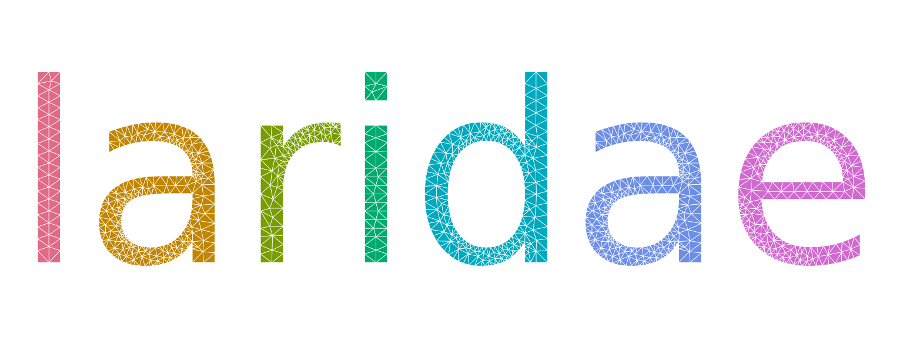
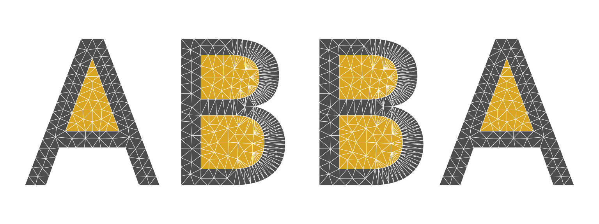
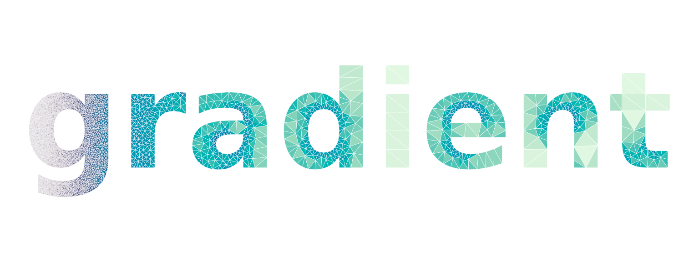
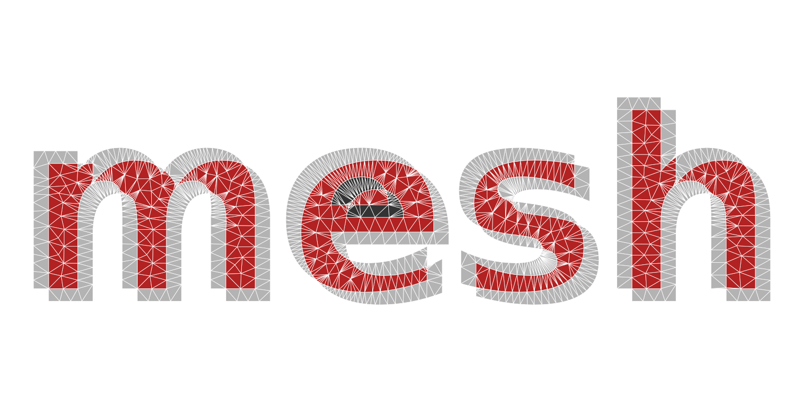
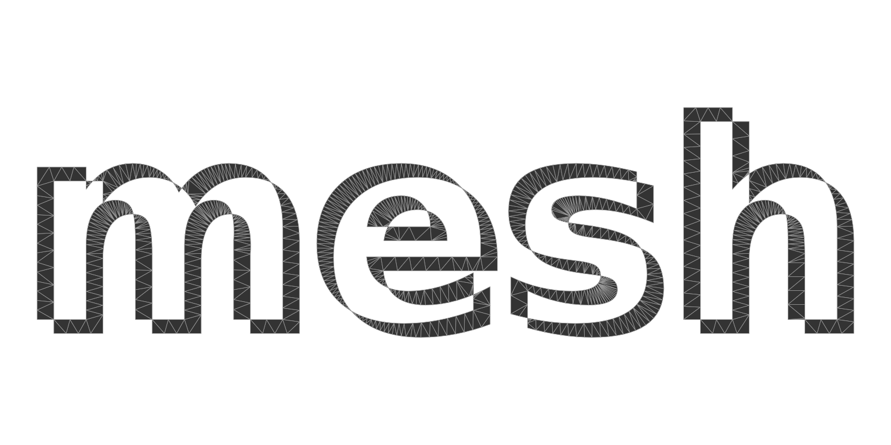

# Meshed text

A letter is a polygon with holes: an outer ring for the shape and an
inner ring for each counter (the enclosed space in A, B, O, 8, g). That
is exactly what a constrained triangulation is built for, so laridae can
turn any text in any installed font into a mesh for design work:
shading, sizing fields, overlaps, extrusion, or as a domain for a field
on a mesh.

The outlines come from the font itself.
[`lari_text_outline()`](https://hypertidy.github.io/laridae/reference/lari_text_outline.md)
shapes the string with ‘textshaping’ (kerning, ligatures and font
fallback included) and flattens each glyph’s curves with
[`systemfonts::glyph_outline()`](https://systemfonts.r-lib.org/reference/glyph_outline.html).
Both packages are only suggested by laridae.

``` r

library(laridae)
o <- lari_text_outline("ABO")
head(o)
#>           x         y glyph ring char
#> 1 0.2080156 0.5048438     1    1    A
#> 2 0.4760781 0.5048438     1    1    A
#> 3 0.3417969 0.8676719     1    1    A
#> 4 0.3979531 0.9648438     1    2    A
#> 5 0.6757812 0.2358438     1    2    A
#> 6 0.5732500 0.2358438     1    2    A
## one ring per contour: A has a counter, B has two
tapply(o$ring, o$char, max)
#> A B O 
#> 2 3 2
```

Coordinates are in ems (set `em` to scale them), so `max_area` and
`tolerance` mean the same thing for every font.

A small helper draws all triangles in one
[`polygon()`](https://rdrr.io/r/graphics/polygon.html) call, filled by a
per-triangle colour.

``` r

plot_tri <- function(r, col = "grey85", border = "white", lwd = 0.4) {
  V <- r$vertices
  T <- r$triangles
  idx <- rbind(T$v0, T$v1, T$v2, NA)
  op <- par(mar = rep(0.2, 4))
  on.exit(par(op))
  plot(range(V$x), range(V$y), type = "n", asp = 1, axes = FALSE, xlab = "", ylab = "")
  polygon(V$x[idx], V$y[idx], col = col, border = border, lwd = lwd)
}
```

## Letters

[`lari_text()`](https://hypertidy.github.io/laridae/reference/lari_text.md)
meshes each glyph and binds the tables, with a `glyph` and `char` column
so each letter can be treated on its own.

``` r

r <- lari_text("laridae", max_area = 0.0015, min_angle = 25)
nrow(r$triangles)
#> [1] 1729
table(r$triangles$char)
#> 
#>   a   d   e   i   l   r 
#> 778 339 339  68  64 141
plot_tri(r, col = hcl.colors(7, "Dark 3")[r$triangles$glyph])
```



The counters are holes because only odd constraint depth is kept
(`erase = "holes"`): the orientation of the rings does not matter, so a
font that winds its contours either way gives the same letters. With
`erase = "outer"` the counters are meshed too and `depth` tells them
apart.

``` r

r <- lari_text("ABBA", erase = "outer", max_area = 0.002)
plot_tri(r, col = c("grey30", "goldenrod")[r$triangles$depth])
```



## Sizing fields

Any sizing field of
[`lari_refine()`](https://hypertidy.github.io/laridae/reference/lari_refine.md)
works: here the largest allowed triangle area grows steeply from left to
right across the word, and the triangles are shaded by their area.

``` r

r <- lari_text("gradient", weight = "bold", tolerance = 0.01,
               size = function(x, y) 2e-5 + 1e-3 * x^3, min_angle = 25)
V <- r$vertices
T <- r$triangles
area <- abs((V$x[T$v1] - V$x[T$v0]) * (V$y[T$v2] - V$y[T$v0]) -
            (V$x[T$v2] - V$x[T$v0]) * (V$y[T$v1] - V$y[T$v0])) / 2
pal <- hcl.colors(64, "Mako")
plot_tri(r, col = pal[cut(log(area), 64)], border = "white", lwd = 0.3)
```



## Overlaps

With `merge = TRUE` all glyphs go into one mesh, so where they overlap
the constraints cross and the depth stacks. Two copies of a word,
slightly offset, show the overlap as depth 2: kept with
`erase = "outer"`, or cut away (an exclusive-or of the two) with the
default `erase = "holes"`.

``` r

o <- lari_text_outline("mesh", weight = "bold")
o2 <- transform(o, x = x + 0.06, y = y - 0.05, glyph = glyph + max(o$glyph))
both <- rbind(o, o2)
r <- lari_glyphs(both, merge = TRUE, erase = "outer", max_area = 0.002)
plot_tri(r, col = c("grey70", "firebrick", "grey20", "firebrick")[r$triangles$depth])
```



``` r

r <- lari_glyphs(both, merge = TRUE, max_area = 0.002)
plot_tri(r, col = "grey20", border = "grey60")
```



## Other outline sources

[`lari_glyphs()`](https://hypertidy.github.io/laridae/reference/lari_glyphs.md)
takes any data frame of rings with `x`, `y` and glyph and ring ids, so
outlines from other tools mesh as they are. The output of
`string2path::string2path()` (columns `glyph_id`, `path_id`) and of
[`systemfonts::glyph_outline()`](https://systemfonts.r-lib.org/reference/glyph_outline.html)
(`glyph`, `contour`) are recognised, and a ring may repeat its first
vertex or not. (string2path is not currently on CRAN; it installs from
<https://yutannihilation.r-universe.dev>, and the chunk below only runs
when it is installed.)

``` r

font <- systemfonts::match_fonts("serif")$path
d <- string2path::string2path("Rings", font)
r <- lari_glyphs(d, max_area = 0.002, min_angle = 30)
plot_tri(r, col = "grey95", border = "grey30")
```
